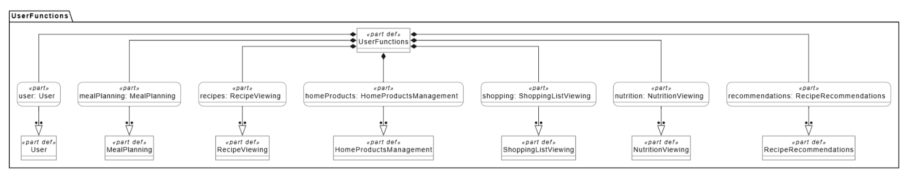
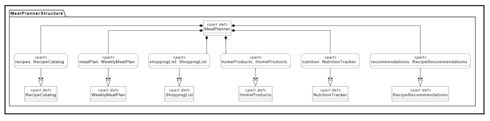

# Описание дизайна программного обеспечения

**Для веб-приложения «Умный планировщик питания»**  
**Версия:** 0.1 (проект)  
**Подготовила:** Кабанова Юлия Алексеевна  
**Организация:** БГУИР  
**Дата изменения:** 2026-11-03

## Оглавление

- [1. Введение](#1-introduction)
- [2. Обзор дизайна](#2-design-overview)
- [3. Проектные представления](#3-design-views)
- [4. Решения](#4-decisions)
- [5. Приложения](#5-appendixes)

## История изменений

| Автор | Дата | Причина изменения | Версия |
|---|---|---|---|
| Кабанова Ю. А. | 2026-11-03 | Первоначальное описание проектируемой архитектуры на основе SRS | 0.1 |

---

## 1. Введение {#1-introduction}

### 1.1 Назначение документа {#11-document-purpose}

Данный SDD описывает проектируемую архитектуру веб-приложения «Умный планировщик питания», основные компоненты, их обязанности, способы взаимодействия и структуру данных. Документ предназначен для разработчиков, архитектора, тестировщика и сопровождающего специалиста. Он служит основой для реализации требований, зафиксированных в SRS, и оценки последствий будущих изменений.

### 1.2 Область применения {#12-subject-scope}

Проектируемая система предназначена для составления недельного меню, выбора рецептов, расчёта КБЖУ, учёта домашних запасов и автоматического формирования списка покупок. В первоначальную версию после дополнительного согласования включён учёт сроков годности продуктов с предупреждениями внутри приложения (`REQ-FUNC-011`). Основные действия выполняются через веб-браузер; данные сохраняются на сервере.

В текущую область проектирования **не входят** встроенная покупка продуктов, медицинские рекомендации, отдельные мобильные приложения, расширенный подбор блюд по запасам (`REQ-FUNC-009`) и перетаскивание рецептов в календарь (`REQ-FUNC-002`). Последние две функции отложены на последующие версии.

### 1.3 Определения, акронимы и сокращения {#13-definitions-acronyms-and-abbreviations}

| Термин | Определение |
|---|---|
| ADR | Architecture Decision Record — запись о принятом архитектурном решении |
| API | Программный интерфейс взаимодействия компонентов |
| Backend | Серверная часть, обрабатывающая данные и бизнес-правила |
| Frontend | Пользовательская часть веб-приложения |
| JSON | Формат обмена структурированными данными |
| КБЖУ | Калорийность, белки, жиры и углеводы |
| MVP | Первоначальная версия с необходимыми функциями |
| REST | Подход к организации интерфейса клиент–сервер |
| SDD | Software Design Description — описание проектного решения ПО |
| SRS | Software Requirements Specification — спецификация требований к ПО |

### 1.4 Ссылки {#14-references}

| Документ | Тип | Назначение | Расположение |
|---|---|---|---|
| SRS «Умный планировщик питания», версия 0.1 | Основной | Исходные функциональные и нефункциональные требования | `../srs.md` |
| Основные возможности пользователя | Справочный | Перечень пользовательских возможностей | `../diagrams/user-functions.png` |
| Функциональная структура приложения | Справочный | Группировка функциональных модулей | `../diagrams/meal-planner-structure.png` |
| ADR проекта | Проектный | Обоснование выбранных архитектурных решений | `../adr/` |

### 1.5 Обзор документа {#15-document-overview}

Во втором разделе представлены архитектурный подход, интересы участников проекта и выбранные точки зрения. Третий раздел описывает компоненты, данные и основные сценарии взаимодействия. Четвёртый раздел фиксирует архитектурные решения и рассматриваемые альтернативы. В пятом разделе приведены ссылки на диаграммы и дополнительные материалы. При изменении решений документ обновляется с указанием даты и версии.

---

## 2. Обзор дизайна {#2-design-overview}

### 2.1 Задачи стейкхолдеров {#21-stakeholder-concerns}

| Участник | Основные интересы | Отражение в проекте |
|---|---|---|
| Пользователь | Простое составление меню, актуальный список покупок, понятные предупреждения о сроках годности | Календарь питания, каталог рецептов, раздел запасов и уведомлений |
| Заказчик | Реализация важнейших функций в согласованные сроки и бюджет | Модульная архитектура, выделение MVP и отложенных функций |
| Разработчик | Понятное разделение обязанностей, удобство тестирования и расширения | Отдельные клиентская, серверная части и база данных |
| Тестировщик | Проверяемые результаты для каждого требования | Сценарии взаимодействия, правила расчёта и проверки данных |
| Сопровождающий специалист | Выявление ошибок и безопасное изменение настроек | Журналирование и внешняя конфигурация подключений |

### 2.2 Выбранные точки зрения {#22-selected-viewpoints}

Ниже описаны точки зрения, предусмотренные исходным шаблоном SDD. Подробные проектные представления перечислены в разделе 3.

#### 2.2.1 Контекст {#221-context}

Система взаимодействует с пользователем через браузер. Пользователь выбирает рецепты, изменяет недельный план и домашние запасы, просматривает покупки и уведомления. Внешний сервис рецептов допускается как перспективная интеграция, но не является обязательной зависимостью MVP.

#### 2.2.2 Композиция {#222-composition}

Архитектура разделяется на пользовательский интерфейс, серверную часть с прикладными модулями и базу данных PostgreSQL. Основные функциональные модули: рецепты, план питания, покупки, домашние продукты, расчёт КБЖУ и сроки годности.

#### 2.2.3 Логическое представление {#223-logical}

Ключевые сущности: `Recipe`, `Ingredient`, `RecipeIngredient`, `MealPlan`, `PlannedMeal`, `PantryItem`, `ShoppingListItem` и `ExpiryNotification`. Связи между ними позволяют получать ингредиенты выбранных блюд, рассчитывать потребности и учитывать остатки продуктов.

#### 2.2.4 Физическое представление {#224-physical}

Веб-клиент выполняется в браузере пользователя; серверная часть и PostgreSQL размещаются в доступном серверном окружении. Специальное оборудование для работы системы не требуется.

#### 2.2.5 Структура {#225-structure}

Клиентская часть содержит компоненты календаря, карточки рецепта, списка покупок, домашних запасов и уведомлений. Серверная часть содержит обработчики запросов, сервисы бизнес-логики и слой доступа к данным.

#### 2.2.6 Зависимости {#226-dependency}

План питания использует каталог рецептов; список покупок зависит от плана, состава рецептов и домашних запасов; расчёт КБЖУ зависит от выбранных порций; предупреждения о сроках годности используют записи домашних запасов. Зависимости должны быть направлены от прикладных модулей к согласованным интерфейсам, а не к элементам представления.

#### 2.2.7 Информация {#227-information}

Постоянно сохраняются рецепты и их ингредиенты, запланированные блюда, количество порций, домашние продукты, сроки годности и пользовательские позиции списка покупок. Для количеств продукта необходимо хранить единицы измерения, чтобы не суммировать несовместимые значения.

#### 2.2.8 Интерфейс {#228-interface}

Браузер обменивается с сервером JSON-данными через HTTP API. Предусматриваются операции чтения, добавления, изменения и удаления планов, запасов и покупок. Ошибки валидации возвращаются в структурированном виде для отображения пользователю.

#### 2.2.9 Взаимодействие {#229-interaction}

При добавлении рецепта в календарь клиент отправляет запрос на изменение плана. Сервер сохраняет запись, пересчитывает сводное КБЖУ и требуемые ингредиенты, после чего возвращает актуальное состояние для отображения.

#### 2.2.10 Алгоритм {#2210-algorithm}

Для списка покупок система собирает ингредиенты всех запланированных блюд, приводит количества к совместимым единицам, объединяет одинаковые ингредиенты и вычитает доступные домашние запасы. Результат не может содержать отрицательных количеств. Для предупреждений сравнивается дата окончания срока годности с текущей датой: просроченные продукты выделяются отдельно, а продукты с приближающимся сроком показываются в разделе предупреждений.

#### 2.2.11 Динамика состояний {#2211-state-dynamics}

Запланированное блюдо может быть добавлено, изменено или удалено. Позиция списка покупок может иметь состояния «Не куплено» и «Куплено». Продукт в домашних запасах рассматривается как «Годен», «Срок скоро истекает» или «Просрочен»; состояние определяется датой годности, а не отдельным ручным переключателем.

#### 2.2.12 Параллелизм {#2212-concurrency}

Операции изменения плана и домашних запасов могут поступать почти одновременно. Сервер должен сохранять согласованность записей и пересчитывать производные данные на основе актуального состояния. На этапе MVP отдельная сложная система распределённой синхронизации не предусматривается.

#### 2.2.13 Паттерны {#2213-patterns}

Для разделения ответственности выбран многоуровневый клиент–серверный подход. На клиенте используются повторно используемые React-компоненты; на сервере разграничиваются обработка HTTP-запросов, прикладные сервисы и доступ к данным.

#### 2.2.14 Развёртывание {#2214-deployment}

Для учебной версии предполагается централизованное развёртывание: веб-клиент, один сервер приложения и PostgreSQL. Конкретная платформа размещения и технология серверной реализации определяются перед реализацией и фиксируются в ADR.

#### 2.2.15 Ресурсы {#2215-resources}

Наиболее существенные ресурсы — соединения с базой данных, память для обработки рецептов и сетевые запросы. Вычисление списка покупок и КБЖУ запускается при изменении связанных данных; следует избегать полного пересчёта при каждом изменении только внешнего вида интерфейса.

---

## 3. Проектные представления {#3-design-views}

### DV-001 — Контекст и состав системы

- **ID:** DV-001
- **Title:** Контекст и функциональная декомпозиция
- **Viewpoint:** Контекст, композиция, структура
- **Representation:** Пользователь работает через React-интерфейс, который обращается к серверной части. Сервер предоставляет функции каталога рецептов, недельного планирования, покупок, домашних запасов, КБЖУ и уведомлений. Функциональное разбиение показано на [диаграмме структуры](../diagrams/meal-planner-structure.png).
- **More Information:** Реализует `REQ-FUNC-001`, `003`, `005`–`008`, `010`, `011`; архитектурные решения — AD-001 и AD-002.

### DV-002 — Модель данных

- **ID:** DV-002
- **Title:** Данные рецептов, планов и запасов
- **Viewpoint:** Логическое представление, информация
- **Representation:**

| Сущность | Основные поля | Назначение |
|---|---|---|
| `Recipe` | `id`, `name`, `servings`, `preparation_time` | Описание рецепта |
| `Ingredient` | `id`, `name`, `unit` | Справочник продуктов |
| `RecipeIngredient` | `recipe_id`, `ingredient_id`, `quantity` | Состав рецепта |
| `MealPlan` | `id`, `week_start` | Недельный план |
| `PlannedMeal` | `plan_id`, `recipe_id`, `day`, `meal_type`, `servings` | Размещение рецепта в календаре |
| `PantryItem` | `id`, `ingredient_id`, `quantity`, `expiry_date` | Продукты дома и сроки годности |
| `ShoppingListItem` | `id`, `ingredient_id`, `quantity`, `manual`, `purchased` | Рассчитанные и вручную добавленные покупки |

Показатели КБЖУ хранятся в данных о рецепте или ингредиентах в согласованной форме и пересчитываются при изменении числа порций. Правила преобразования единиц измерения уточняются до реализации.
- **More Information:** `REQ-FUNC-001`, `003`, `005`–`008`, `010`, `011`; решение AD-003.

### DV-003 — Формирование списка покупок

- **ID:** DV-003
- **Title:** Расчёт потребности в продуктах
- **Viewpoint:** Взаимодействие, алгоритм
- **Representation:**
  1. Получить рецепты и количество порций из недельного плана.
  2. Определить необходимое количество каждого ингредиента.
  3. Объединить совпадающие ингредиенты в совместимых единицах.
  4. Вычесть количество продуктов, указанное пользователем как доступное дома.
  5. Сформировать позиции с недостающим количеством и сохранить пользовательские ручные позиции.
  6. Вернуть клиенту обновлённый список.

  Если домашнего продукта достаточно, рассчитанная недостающая потребность равна нулю. Отрицательные результаты исключаются.
- **More Information:** `REQ-FUNC-005`, `006`, `007`, `010`.

### DV-004 — Контроль сроков годности

- **ID:** DV-004
- **Title:** Проверка дат и отображение предупреждений
- **Viewpoint:** Алгоритм, динамика состояний
- **Representation:** При вводе продукта пользователь может указать дату окончания срока годности. При открытии раздела домашних запасов сервер сравнивает её с текущей датой и возвращает статус продукта. В проекте предлагается показывать предупреждение за три дня до истечения срока; этот порог является **предварительным проектным параметром**, который следует согласовать с заказчиком. Для MVP предусмотрены только уведомления внутри приложения, без email и push-сообщений.
- **More Information:** `REQ-FUNC-011`; влияет на `PantryItem` и раздел уведомлений.

### DV-005 — Обмен данными

- **ID:** DV-005
- **Title:** Контракты интерфейсов клиент–сервер
- **Viewpoint:** Интерфейс, взаимодействие
- **Representation:** Проектируемые группы операций: `/api/recipes` (чтение рецептов), `/api/plans` (недельный план), `/api/pantry` (домашние запасы), `/api/shopping-list` (покупки). Ответы содержат JSON и корректные коды HTTP; ошибки неверного ввода возвращают пояснение для пользователя. Имена URL являются предварительными и уточняются при проектировании API.
- **More Information:** `REQ-INT-007`, `008`; решение AD-002.

---

## 4. Решения {#4-decisions}

### AD-001 — Веб-интерфейс на React

- **ID:** AD-001
- **Title:** Использование React для клиентской части
- **Context:** Интерфейс должен содержать взаимосвязанные интерактивные экраны: календарь, каталог, покупки и уведомления.
- **Options:** React; другое компонентное веб-решение; интерфейс без компонентной библиотеки.
- **Outcome:** Выбран **React**, поскольку компонентная модель позволяет повторно использовать элементы и управлять обновлением связанных экранов. Решение согласуется с ранее установленным технологическим ограничением проекта.
- **More Information:** Отдельная ADR-запись может быть оформлена на основе `../adr/adr-template.md`.

### AD-002 — Разделение на клиент и сервер

- **ID:** AD-002
- **Title:** Клиент–серверная архитектура с HTTP API
- **Context:** Расчёт списков покупок, сохранение данных и проверка сроков годности должны выполняться согласованно для всех пользовательских экранов.
- **Options:** Логика целиком в браузере; клиент–сервер с единым приложением; распределённые микросервисы.
- **Outcome:** Выбрана **клиент–серверная архитектура с одним серверным приложением**. Она достаточно проста для учебного MVP, позволяет централизовать правила обработки данных и не требует усложнения распределённой инфраструктурой.
- **More Information:** Конкретный язык и серверный фреймворк пока не утверждены и не должны выдаваться за принятые решения.

### AD-003 — Постоянное хранение в PostgreSQL

- **ID:** AD-003
- **Title:** Реляционная база данных PostgreSQL
- **Context:** Рецепты связаны с ингредиентами, недельный план — с блюдами, а домашние запасы влияют на вычисляемый список покупок.
- **Options:** PostgreSQL; другая реляционная СУБД; файловое хранение.
- **Outcome:** Выбрана **PostgreSQL** благодаря поддержке структурированных связей, ограничений целостности и транзакционной обработки изменений.
- **More Information:** `REQ-INT-008`, `REQ-REL-001`.

### AD-004 — Уведомления о сроках годности внутри приложения

- **ID:** AD-004
- **Title:** Локальные для веб-интерфейса предупреждения о сроках годности
- **Context:** Заказчик включил новую функцию в MVP, сохранив ранее согласованный срок выпуска.
- **Options:** Уведомления внутри приложения; email; push-уведомления.
- **Outcome:** Для первой версии выбраны **предупреждения в интерфейсе**. Они не требуют отдельной системы доставки сообщений и соответствуют ограниченному объёму работ. При необходимости дополнительные каналы можно предусмотреть позднее.
- **More Information:** `REQ-FUNC-011`; согласовать предварительный порог предупреждения в три дня.

---

## 5. Приложения {#5-appendixes}

### 5.1 Диаграмма основных возможностей пользователя

### 5.2 Диаграмма функциональной структуры

### 5.3 Связанные материалы

- [Спецификация SRS](../srs.md) — исходные требования к веб-приложению.
- Каталог `../adr/` — записи об отдельных архитектурных решениях, оформляемые по предоставленному шаблону ADR.

**Открытые вопросы перед реализацией:** конкретная серверная технология; правила пересчёта единиц измерения продуктов; срок предварительного предупреждения о годности; способ привязки планов к пользователям. Данные вопросы должны быть согласованы и отражены в следующей версии SDD.
