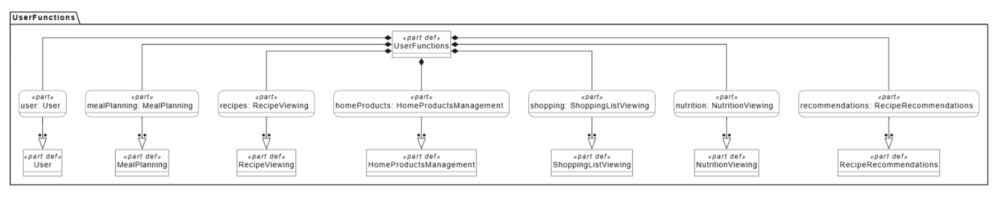
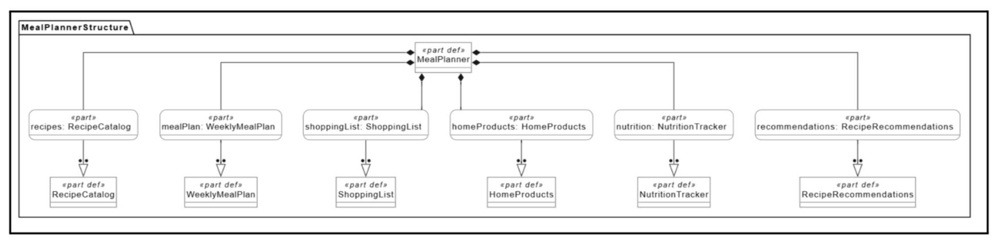

# Спецификация требований к ПО

Для веб-приложения **«Умный планировщик питания»**

**Версия:** 0.1  
**Подготовила:** Кабанова Юлия Алексеевна  
**БГУИР**  
**Дата:** 20.10.2026

---

## Оглавление

- [1. Введение](#1-введение)
- [2. Обзор продукта](#2-обзор-продукта)
- [3. Требования](#3-требования)
- [4. Верификация](#4-верификация)
- [5. Приложения](#5-приложения)

## История изменений

| Автор | Дата | Причина изменения | Версия |
|---|---|---|---|
| Кабанова Юлия Алексеевна | 20.10.2026 | Создание первоначальной версии спецификации | 0.1 |

---

# 1. Введение

## 1.1 Назначение документа

Настоящий документ содержит спецификацию требований к веб-приложению **«Умный планировщик питания»**. Документ фиксирует назначение продукта, его границы, основные функции, ограничения и критерии, по которым в дальнейшем можно проверить соответствие реализованной системы требованиям.

Спецификация предназначена для согласования единого понимания будущего продукта между заказчиком, разработчиком и лицами, выполняющими проверку результата. Основное внимание уделяется тому, **что** должна обеспечивать система с точки зрения пользователя, а детали реализации приводятся только там, где они являются ограничением проекта.

## 1.2 Область применения продукта

«Умный планировщик питания» — веб-приложение для составления рациона на неделю и автоматизации связанных с ним действий. Пользователь выбирает рецепты и размещает их в календаре по дням и приёмам пищи, после чего система формирует список необходимых продуктов, учитывает запасы, имеющиеся дома, и рассчитывает КБЖУ.

**В область применения входят:**
- планирование завтраков, обедов, ужинов и перекусов на неделю;
- просмотр и поиск рецептов;
- добавление рецептов в календарь;
- автоматическое формирование списка покупок;
- учёт продуктов, которые уже имеются дома;
- расчёт калорийности, белков, жиров и углеводов;
- рекомендации блюд на основании имеющихся ингредиентов;
- редактирование плана питания с автоматическим обновлением связанных данных.

**В текущую версию не входят:**
- оформление и оплата заказов в продуктовых магазинах;
- доставка продуктов;
- консультации врача или диетолога;
- медицинские рекомендации;
- автоматическое распознавание продуктов по фотографии;
- нативные приложения для iOS и Android.

## 1.3 Определения, акронимы и сокращения

| Термин | Определение |
|---|---|
| SRS | Software Requirements Specification — спецификация требований к программному обеспечению |
| UI | User Interface — пользовательский интерфейс |
| API | Программный интерфейс для обмена данными между системами |
| КБЖУ | Калории, белки, жиры и углеводы |
| План питания | Набор выбранных блюд, распределённых по дням недели и приёмам пищи |
| Рецепт | Описание блюда с перечнем ингредиентов, количеством порций и пищевой ценностью |
| Продукты дома | Перечень ингредиентов, которые пользователь указал как имеющиеся |
| Список покупок | Перечень продуктов, необходимых для запланированных блюд |
| Drag-and-drop | Перетаскивание элемента интерфейса мышью или сенсорным вводом |

## 1.4 Ссылки

| Название | Тип | Назначение |
|---|---|---|
| ISO/IEC/IEEE 29148:2018 | Нормативный | Общие принципы инженерии требований |
| `diagrams/user-functions.png` | Внутренний артефакт | Основные возможности пользователя |
| `diagrams/meal-planner-structure.png` | Внутренний артефакт | Функциональная структура приложения |

## 1.5 Обзор документа

Раздел 1 определяет назначение спецификации и границы продукта. Раздел 2 описывает продукт в целом, его пользователей, функции и зависимости. Раздел 3 содержит детализированные и проверяемые требования. Раздел 4 определяет способы их верификации. В разделе 5 приведены графические материалы проекта.

Слово **«должна»** используется для обязательных требований. Изменения спецификации фиксируются в истории изменений и в системе контроля версий Git.

---

# 2. Обзор продукта

## 2.1 Перспектива продукта

«Умный планировщик питания» разрабатывается как самостоятельное веб-приложение. Оно объединяет задачи, которые пользователь обычно решает раздельно: поиск рецептов, составление недельного меню, расчёт пищевой ценности, проверку домашних запасов и подготовку списка покупок.

Основная ценность продукта заключается в связи этих действий между собой. После изменения плана питания пользователь не должен вручную пересчитывать ингредиенты и заново составлять список покупок — связанные данные обновляются системой.

При необходимости приложение может взаимодействовать с внешним сервисом рецептов или пищевой ценности через API. Хранение пользовательских планов, рецептов, запасов и списков покупок выполняется в базе данных.

## 2.2 Функции продукта

Основные функции приложения:
- создание и редактирование недельного плана питания;
- распределение рецептов по дням и приёмам пищи;
- просмотр каталога и карточек рецептов;
- поиск и фильтрация рецептов;
- расчёт КБЖУ отдельных блюд и рациона;
- автоматическое объединение ингредиентов из запланированных рецептов;
- формирование списка недостающих продуктов;
- ручное редактирование списка покупок;
- ведение перечня продуктов, имеющихся дома;
- подбор рецептов из доступных ингредиентов.

## 2.3 Ограничения продукта

- продукт реализуется как веб-приложение;
- интерфейс основной версии выполняется на русском языке;
- клиентская часть разрабатывается с использованием React;
- данные предметной области хранятся в PostgreSQL;
- система не выполняет медицинскую оценку рациона;
- значения КБЖУ являются информационными и зависят от исходных данных рецепта;
- функции, использующие внешний API, требуют подключения к Интернету;
- приложение не выполняет покупку или оплату товаров от имени пользователя.

## 2.4 Характеристики пользователей

Основной пользователь системы — человек, самостоятельно составляющий рацион и список продуктов. Для работы с приложением достаточно базовых навыков использования браузера.

Целевая аудитория включает студентов, работающих пользователей, семьи и людей, которым важно заранее организовывать питание или контролировать приблизительную пищевую ценность рациона.

## 2.5 Допущения и зависимости

**Допущения:**
- пользователь использует современный браузер с поддержкой JavaScript;
- для синхронизации и сохранения данных доступно интернет-соединение;
- сведения о продуктах дома вводятся и поддерживаются самим пользователем;
- корректность КБЖУ зависит от корректности данных рецепта и количества порций.

**Зависимости:**
- PostgreSQL используется для постоянного хранения данных;
- при подключении внешнего API часть функций зависит от его доступности;
- работа веб-интерфейса зависит от доступности серверной части.

## 2.6 Распределение требований

| Компонент | Связанные требования | Зона ответственности |
|---|---|---|
| План питания | REQ-FUNC-001, REQ-FUNC-002, REQ-INT-001 | Календарь недели и размещение блюд |
| Рецепты | REQ-FUNC-003, REQ-FUNC-004, REQ-INT-002 | Просмотр и поиск рецептов |
| Список покупок | REQ-FUNC-005, REQ-FUNC-006, REQ-INT-003 | Формирование и редактирование покупок |
| Продукты дома | REQ-FUNC-007, REQ-INT-004 | Учёт имеющихся ингредиентов |
| КБЖУ | REQ-FUNC-008, REQ-INT-005 | Расчёт и отображение пищевой ценности |
| Рекомендации | REQ-FUNC-009 | Подбор блюд по имеющимся продуктам |

---

# 3. Требования

## 3.1 Внешние интерфейсы

### 3.1.1 Пользовательские интерфейсы

### REQ-INT-001: Недельный план
- **Статус:** Предложено
- **Дата:** 2026-10-20
- **Формулировка:** Система должна предоставлять недельный календарь с разделением дней по приёмам пищи.
- **Обоснование:** Календарь является основным рабочим пространством приложения.
- **Критерии приёмки:** отображаются семь дней недели; для каждого дня доступны основные приёмы пищи; добавленный рецепт отображается в выбранной ячейке.
- **Метод верификации:** Демонстрация.

### REQ-INT-002: Каталог рецептов
- **Статус:** Предложено
- **Дата:** 2026-10-20
- **Формулировка:** Система должна предоставлять каталог рецептов с возможностью просмотра основной информации о блюде.
- **Обоснование:** Пользователь должен выбрать блюдо до добавления его в план.
- **Критерии приёмки:** для рецепта отображаются название и основные характеристики; карточка рецепта открывается; доступен поиск по названию.
- **Метод верификации:** Демонстрация.

### REQ-INT-003: Список покупок
- **Статус:** Предложено
- **Дата:** 2026-10-20
- **Формулировка:** Система должна отображать сформированный список покупок с возможностью отмечать приобретённые позиции.
- **Обоснование:** Пользователю нужен единый актуальный перечень необходимых продуктов.
- **Критерии приёмки:** каждая позиция содержит название и количество; позицию можно отметить купленной; состояние визуально изменяется.
- **Метод верификации:** Тест.

### REQ-INT-004: Раздел «Продукты дома»
- **Статус:** Предложено
- **Дата:** 2026-10-20
- **Формулировка:** Система должна предоставлять интерфейс для добавления, изменения и удаления имеющихся продуктов.
- **Обоснование:** Эти данные используются при формировании покупок и рекомендаций.
- **Критерии приёмки:** продукт можно добавить, изменить и удалить; изменения сохраняются.
- **Метод верификации:** Тест.

### REQ-INT-005: Отображение КБЖУ
- **Статус:** Предложено
- **Дата:** 2026-10-20
- **Формулировка:** Система должна отображать калорийность и количество белков, жиров и углеводов для выбранного периода.
- **Обоснование:** Пользователю нужна сводная информация о пищевой ценности рациона.
- **Критерии приёмки:** отображаются четыре показателя; значения изменяются после изменения плана.
- **Метод верификации:** Тест.

### REQ-INT-006: Адаптивность интерфейса
- **Статус:** Предложено
- **Дата:** 2026-10-20
- **Формулировка:** Система должна корректно отображать основные экраны на компьютере и смартфоне.
- **Обоснование:** Приложение предполагает использование с разных устройств.
- **Критерии приёмки:** интерфейс остаётся читаемым при ширине 375 px и 1920 px; основные действия доступны мышью и через сенсорный экран.
- **Метод верификации:** Тест.

### 3.1.2 Аппаратные интерфейсы

Специализированные аппаратные интерфейсы не требуются. Используются стандартные устройства ввода: клавиатура, мышь и сенсорный экран.

### 3.1.3 Программные интерфейсы

### REQ-INT-007: Взаимодействие клиента и сервера
- **Статус:** Предложено
- **Дата:** 2026-10-20
- **Формулировка:** Серверная часть должна предоставлять интерфейс обмена данными с веб-клиентом.
- **Обоснование:** Клиенту необходимо получать и изменять планы, рецепты, продукты и списки покупок.
- **Критерии приёмки:** данные передаются в JSON; запросы возвращают корректные HTTP-статусы.
- **Метод верификации:** Тест.

### REQ-INT-008: Хранение данных
- **Статус:** Предложено
- **Дата:** 2026-10-20
- **Формулировка:** Система должна обеспечивать постоянное хранение планов питания, рецептов, домашних продуктов и списков покупок в PostgreSQL.
- **Обоснование:** Данные должны сохраняться между сеансами.
- **Критерии приёмки:** после перезапуска приложения сохранённые данные доступны.
- **Метод верификации:** Тест.

### REQ-INT-009: Внешний API рецептов
- **Статус:** Отложено
- **Дата:** 2026-10-20
- **Формулировка:** При подключении внешнего сервиса система должна получать сведения о рецептах или пищевой ценности через его API.
- **Обоснование:** Это позволяет расширять каталог без ручного заполнения всех данных.
- **Критерии приёмки:** корректный ответ преобразуется во внутренний формат; при недоступности сервиса выводится сообщение об ошибке.
- **Метод верификации:** Тест.
- **Дополнительная информация:** Конкретный поставщик API выбирается позднее.

## 3.2 Функциональные требования

### REQ-FUNC-001: Создание недельного плана
- **Статус:** Предложено
- **Дата:** 2026-10-20
- **Формулировка:** Система должна позволять пользователю распределять рецепты по дням недели и приёмам пищи.
- **Обоснование:** Планирование рациона является центральной функцией продукта.
- **Критерии приёмки:** рецепт можно добавить и удалить; сохранённый план доступен после повторного открытия.
- **Метод верификации:** Тест.

### REQ-FUNC-002: Drag-and-drop
- **Статус:** Предложено
- **Дата:** 2026-10-20
- **Формулировка:** Система должна позволять добавлять рецепт в план посредством drag-and-drop.
- **Обоснование:** Перетаскивание сокращает число действий при составлении меню.
- **Критерии приёмки:** карточка переносится в доступную ячейку; после отпускания рецепт появляется в выбранном месте.
- **Метод верификации:** Демонстрация.

### REQ-FUNC-003: Карточка рецепта
- **Статус:** Предложено
- **Дата:** 2026-10-20
- **Формулировка:** Система должна отображать состав ингредиентов, количество порций, время приготовления и КБЖУ рецепта.
- **Обоснование:** Пользователь должен оценить блюдо до включения его в рацион.
- **Критерии приёмки:** все перечисленные данные отображаются в карточке.
- **Метод верификации:** Инспекция.

### REQ-FUNC-004: Поиск и фильтрация рецептов
- **Статус:** Предложено
- **Дата:** 2026-10-20
- **Формулировка:** Система должна позволять искать рецепты по названию и фильтровать их по типу приёма пищи.
- **Обоснование:** При большом каталоге ручной просмотр неудобен.
- **Критерии приёмки:** поиск возвращает совпадения; фильтр ограничивает отображаемый набор.
- **Метод верификации:** Тест.

### REQ-FUNC-005: Автоматический список покупок
- **Статус:** Предложено
- **Дата:** 2026-10-20
- **Формулировка:** Система должна автоматически формировать список продуктов на основании рецептов из плана.
- **Обоснование:** Функция уменьшает объём ручной работы.
- **Критерии приёмки:** ингредиенты запланированных блюд учитываются; при изменении плана список пересчитывается.
- **Метод верификации:** Тест.

### REQ-FUNC-006: Объединение одинаковых ингредиентов
- **Статус:** Предложено
- **Дата:** 2026-10-20
- **Формулировка:** Система должна объединять одинаковые ингредиенты из разных рецептов в одну позицию с суммарным количеством.
- **Обоснование:** Дублирование усложняет использование списка.
- **Критерии приёмки:** одинаковый ингредиент отображается один раз; количество соответствует сумме.
- **Метод верификации:** Тест.

### REQ-FUNC-007: Учёт продуктов дома
- **Статус:** Предложено
- **Дата:** 2026-10-20
- **Формулировка:** При формировании списка покупок система должна учитывать количество продуктов, уже имеющихся дома.
- **Обоснование:** Это снижает вероятность лишних покупок.
- **Критерии приёмки:** имеющийся в достаточном количестве продукт не добавляется в покупки; при нехватке добавляется только недостающее количество.
- **Метод верификации:** Тест.

### REQ-FUNC-008: Расчёт КБЖУ
- **Статус:** Предложено
- **Дата:** 2026-10-20
- **Формулировка:** Система должна рассчитывать суммарное КБЖУ выбранных рецептов с учётом количества порций.
- **Обоснование:** Пользователь не должен вручную складывать значения.
- **Критерии приёмки:** итог соответствует данным блюд; изменение порций изменяет итог.
- **Метод верификации:** Анализ и тест.

### REQ-FUNC-009: Рекомендации блюд
- **Статус:** Предложено
- **Дата:** 2026-10-20
- **Формулировка:** Система должна предлагать рецепты, для которых пользователь имеет все или большую часть ингредиентов.
- **Обоснование:** Функция помогает использовать продукты, уже находящиеся дома.
- **Критерии приёмки:** подходящие рецепты появляются в рекомендациях; для неполного набора отображаются недостающие продукты.
- **Метод верификации:** Тест.

### REQ-FUNC-010: Ручное редактирование покупок
- **Статус:** Предложено
- **Дата:** 2026-10-20
- **Формулировка:** Система должна позволять вручную добавлять и удалять позиции списка покупок.
- **Обоснование:** Пользователь может покупать товары, не связанные с рецептами.
- **Критерии приёмки:** пользовательская позиция добавляется, удаляется и сохраняется при автоматическом пересчёте.
- **Метод верификации:** Тест.

## 3.3 Качество обслуживания

### 3.3.1 Производительность

### REQ-PERF-001: Время отклика
- **Статус:** Предложено
- **Дата:** 2026-10-20
- **Формулировка:** Основные операции, не зависящие от внешнего API, должны завершаться не более чем за 2 секунды при штатной нагрузке.
- **Обоснование:** Заметные задержки ухудшают удобство использования.
- **Критерии приёмки:** не менее 95% проверяемых операций укладываются в 2 секунды.
- **Метод верификации:** Тест.

### REQ-PERF-002: Пересчёт данных
- **Статус:** Предложено
- **Дата:** 2026-10-20
- **Формулировка:** После изменения плана список покупок и КБЖУ должны обновляться не более чем за 2 секунды.
- **Обоснование:** Результат изменения должен быть виден без ручного обновления.
- **Критерии приёмки:** новые значения появляются не позднее 2 секунд.
- **Метод верификации:** Тест.

### 3.3.2 Безопасность

### REQ-SEC-001: Защищённая передача данных
- **Статус:** Предложено
- **Дата:** 2026-10-20
- **Формулировка:** При публичном развёртывании обмен данными между браузером и сервером должен выполняться по HTTPS.
- **Обоснование:** Защищённый канал снижает риск перехвата данных.
- **Критерии приёмки:** публичная версия доступна по HTTPS.
- **Метод верификации:** Демонстрация.

### REQ-SEC-002: Валидация ввода
- **Статус:** Предложено
- **Дата:** 2026-10-20
- **Формулировка:** Система должна проверять пользовательские данные перед сохранением.
- **Обоснование:** Некорректные данные могут нарушить целостность информации.
- **Критерии приёмки:** отрицательное количество продукта не сохраняется; обязательное пустое поле вызывает ошибку.
- **Метод верификации:** Тест.

### 3.3.3 Надёжность

### REQ-REL-001: Сохранность данных
- **Статус:** Предложено
- **Дата:** 2026-10-20
- **Формулировка:** Сохранённые планы и пользовательские списки должны оставаться доступными после перезапуска приложения.
- **Обоснование:** Потеря данных делает сервис непригодным для регулярного использования.
- **Критерии приёмки:** после перезапуска данные успешно загружаются из базы.
- **Метод верификации:** Тест.

### REQ-REL-002: Ошибки внешних сервисов
- **Статус:** Предложено
- **Дата:** 2026-10-20
- **Формулировка:** Недоступность внешнего API не должна приводить к прекращению работы всего приложения.
- **Обоснование:** Внешняя зависимость не должна блокировать локальные функции.
- **Критерии приёмки:** выводится понятное сообщение; функции планирования остаются доступны.
- **Метод верификации:** Тест.

### 3.3.4 Доступность

### REQ-AVAIL-001: Доступ к сохранённому плану
- **Статус:** Предложено
- **Дата:** 2026-10-20
- **Формулировка:** При штатной работе сервера и базы данных пользователь должен иметь возможность открыть сохранённый план и список покупок в любое время суток.
- **Обоснование:** Эти данные могут понадобиться пользователю в разное время.
- **Критерии приёмки:** основные страницы открываются без ограничений по времени суток.
- **Метод верификации:** Демонстрация.

### 3.3.5 Наблюдаемость

### REQ-OBS-001: Логирование ошибок
- **Статус:** Предложено
- **Дата:** 2026-10-20
- **Формулировка:** Серверная часть должна фиксировать ошибки обработки запросов и взаимодействия с внешними сервисами.
- **Обоснование:** Логи необходимы для диагностики неисправностей.
- **Критерии приёмки:** при искусственно вызванной ошибке в журнале появляется запись с датой, временем и описанием.
- **Метод верификации:** Инспекция.

## 3.4 Соответствие стандартам

### REQ-COMP-001: Минимизация персональных данных
- **Статус:** Предложено
- **Дата:** 2026-10-20
- **Формулировка:** Система должна хранить только персональные данные, необходимые для предоставления функций приложения.
- **Обоснование:** Минимизация данных снижает риски нарушения конфиденциальности.
- **Критерии приёмки:** в базе отсутствуют персональные поля, не используемые функциями системы.
- **Метод верификации:** Инспекция.

### REQ-COMP-002: Условия сторонних API
- **Статус:** Предложено
- **Дата:** 2026-10-20
- **Формулировка:** Интеграция с внешним API должна выполняться в соответствии с условиями выбранного сервиса.
- **Обоснование:** Нарушение условий может привести к блокировке API.
- **Критерии приёмки:** способ интеграции соответствует документации поставщика.
- **Метод верификации:** Инспекция.

## 3.5 Проектирование и реализация

### 3.5.1 Установка

### REQ-INST-001: Конфигурация окружения
- **Статус:** Предложено
- **Дата:** 2026-10-20
- **Формулировка:** Параметры подключения к базе данных и внешним сервисам не должны храниться непосредственно в исходном коде.
- **Обоснование:** Это снижает риск публикации секретных данных.
- **Критерии приёмки:** реальные пароли и ключи отсутствуют в репозитории; используются переменные окружения.
- **Метод верификации:** Инспекция.

### 3.5.2 Сборка и поставка

### REQ-BUILD-001: Сборка React-клиента
- **Статус:** Предложено
- **Дата:** 2026-10-20
- **Формулировка:** Клиентская часть должна собираться стандартной командой проекта без ручного изменения исходных файлов.
- **Обоснование:** Воспроизводимая сборка необходима для проверки и развёртывания.
- **Критерии приёмки:** команда сборки завершается без ошибок и создаёт production-сборку.
- **Метод верификации:** Тест.

### 3.5.3 Распределение

На этапе учебного MVP допускается централизованное развёртывание клиентской части, серверной части и базы данных без микросервисной архитектуры.

### 3.5.4 Сопровождаемость

### REQ-MAINT-001: Модульность интерфейса
- **Статус:** Предложено
- **Дата:** 2026-10-20
- **Формулировка:** Повторяющиеся элементы интерфейса должны оформляться как переиспользуемые React-компоненты.
- **Обоснование:** Это уменьшает дублирование и упрощает изменения.
- **Критерии приёмки:** повторяющиеся карточки, кнопки и элементы списков не копируются отдельной реализацией.
- **Метод верификации:** Инспекция.

### REQ-MAINT-002: Использование Git
- **Статус:** В работе
- **Дата:** 2026-10-20
- **Формулировка:** Изменения проекта должны фиксироваться в Git и выполняться в отдельных ветках с последующим рассмотрением через Pull Request.
- **Обоснование:** Такой процесс обеспечивает историю изменений и поддержку обратной связи.
- **Критерии приёмки:** репозиторий содержит отдельные ветки, осмысленные коммиты и Pull Request.
- **Метод верификации:** Инспекция.

### 3.5.5 Повторное использование

### REQ-REUSE-001: Переиспользование UI-компонентов
- **Статус:** Предложено
- **Дата:** 2026-10-20
- **Формулировка:** Компоненты, используемые в нескольких частях интерфейса, должны реализовываться повторно используемым способом.
- **Обоснование:** Это облегчает поддержку и сохраняет единообразие интерфейса.
- **Критерии приёмки:** один базовый компонент используется более чем в одном месте без копирования реализации.
- **Метод верификации:** Инспекция.

### 3.5.6 Переносимость

### REQ-PORT-001: Поддержка браузеров
- **Статус:** Предложено
- **Дата:** 2026-10-20
- **Формулировка:** Веб-приложение должно корректно работать в актуальных Chromium-браузерах.
- **Обоснование:** Пользователь не должен быть привязан к одной операционной системе.
- **Критерии приёмки:** основные сценарии выполняются в Google Chrome и Microsoft Edge актуальных версий.
- **Метод верификации:** Тест.

### 3.5.7 Стоимость

### REQ-COST-001: Бесплатные технологии для MVP
- **Статус:** Предложено
- **Дата:** 2026-10-20
- **Формулировка:** Для учебной версии должны использоваться инструменты, не требующие обязательной покупки коммерческих лицензий.
- **Обоснование:** Проект должен быть реализуем без дополнительных лицензионных расходов.
- **Критерии приёмки:** для сборки и запуска основной функциональности не требуется платная лицензия.
- **Метод верификации:** Анализ.

### 3.5.8 Сроки

Разработка выполняется итеративно в течение учебного курса. Сроки отдельных функций уточняются после согласования требований и их приоритета с заказчиком.

### 3.5.9 Доказательство концепции

В качестве доказательства концепции на этапе работы с требованиями используются графические модели, демонстрирующие основные возможности пользователя и функциональную структуру приложения.

### 3.5.10 Управление изменениями

### REQ-CM-001: Изменения через отдельную ветку
- **Статус:** В работе
- **Дата:** 2026-10-20
- **Формулировка:** Изменения требований должны вноситься в отдельной ветке репозитория и представляться через Pull Request.
- **Обоснование:** Это позволяет просматривать и обсуждать изменения до включения в основную версию.
- **Критерии приёмки:** изменения лабораторной работы находятся в отдельной ветке; слияние выполняется через Pull Request.
- **Метод верификации:** Инспекция.

### REQ-CM-002: История изменений
- **Статус:** Предложено
- **Дата:** 2026-10-20
- **Формулировка:** Существенные изменения требований должны сопровождаться новой записью в истории изменений документа.
- **Обоснование:** История позволяет определить, когда и почему спецификация была скорректирована.
- **Критерии приёмки:** после согласованного изменения появляется запись с датой и причиной.
- **Метод верификации:** Инспекция.

---

# 4. Верификация

Используются следующие методы:
- **Тест** — выполнение сценария и сравнение результата с критерием приёмки;
- **Демонстрация** — визуальный показ работы функции;
- **Инспекция** — проверка документации, кода, конфигурации или структуры данных;
- **Анализ** — расчёт или оценка измеряемых показателей.

| ID | Метод | Проверяемый результат | Статус |
|---|---|---|---|
| REQ-INT-001 | Демонстрация | Недельный календарь | Запланировано |
| REQ-INT-003 | Тест | Работа списка покупок | Запланировано |
| REQ-INT-004 | Тест | Управление продуктами дома | Запланировано |
| REQ-INT-005 | Тест | Отображение КБЖУ | Запланировано |
| REQ-FUNC-001 | Тест | Создание и сохранение плана | Запланировано |
| REQ-FUNC-002 | Демонстрация | Перетаскивание рецепта | Запланировано |
| REQ-FUNC-005 | Тест | Автоматический список покупок | Запланировано |
| REQ-FUNC-006 | Тест | Объединение ингредиентов | Запланировано |
| REQ-FUNC-007 | Тест | Учёт домашних запасов | Запланировано |
| REQ-FUNC-008 | Анализ / Тест | Расчёт КБЖУ | Запланировано |
| REQ-FUNC-009 | Тест | Рекомендации рецептов | Запланировано |
| REQ-MAINT-002 | Инспекция | Использование Git | В работе |
| REQ-CM-001 | Инспекция | Работа через Pull Request | В работе |

---

# 5. Приложения

## 5.1 Основные возможности пользователя

Диаграмма показывает ключевые действия пользователя: планирование питания, просмотр рецептов, учёт продуктов дома, работу со списком покупок, просмотр КБЖУ и получение рекомендаций.

**Рисунок 5.1 — Основные возможности пользователя**

## 5.2 Функциональная структура приложения

Диаграмма отражает основные функциональные части системы: каталог рецептов, недельный план, список покупок, продукты дома, расчёт пищевой ценности и рекомендации.

**Рисунок 5.2 — Функциональная структура веб-приложения «Умный планировщик питания»**
